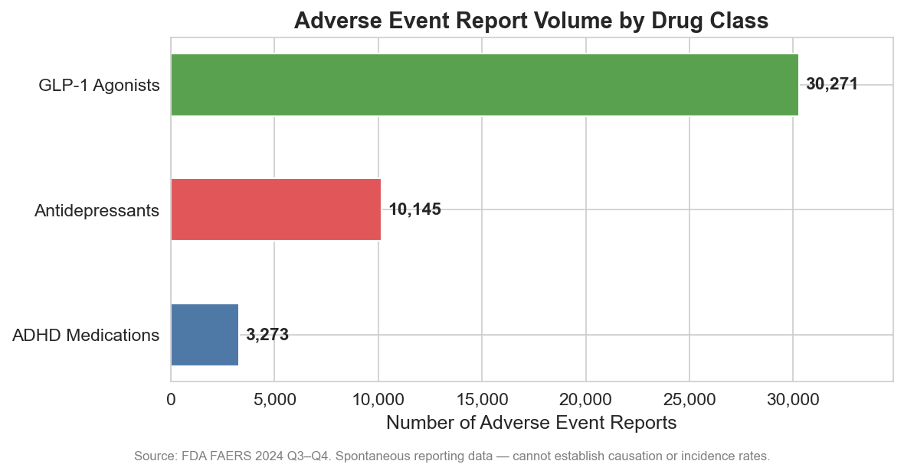
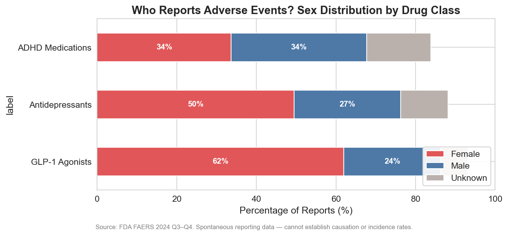
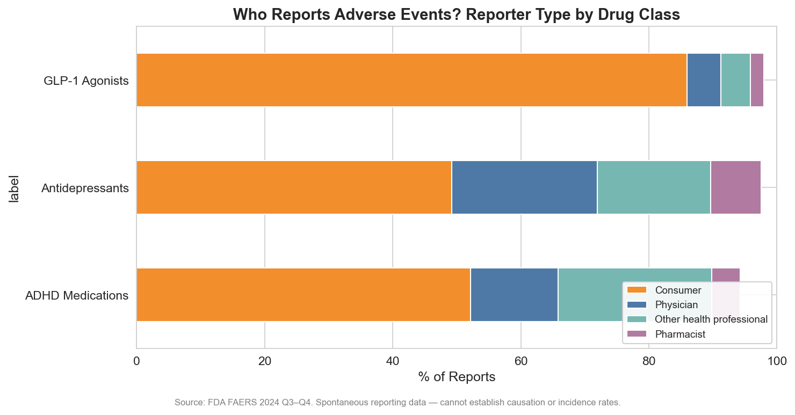
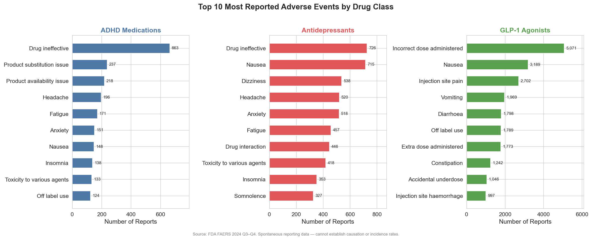
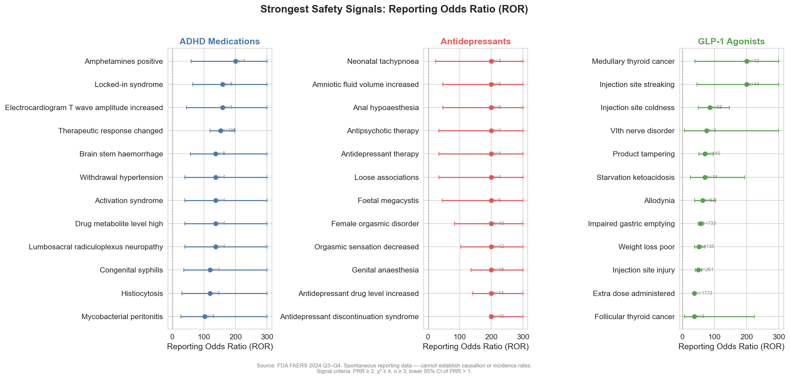
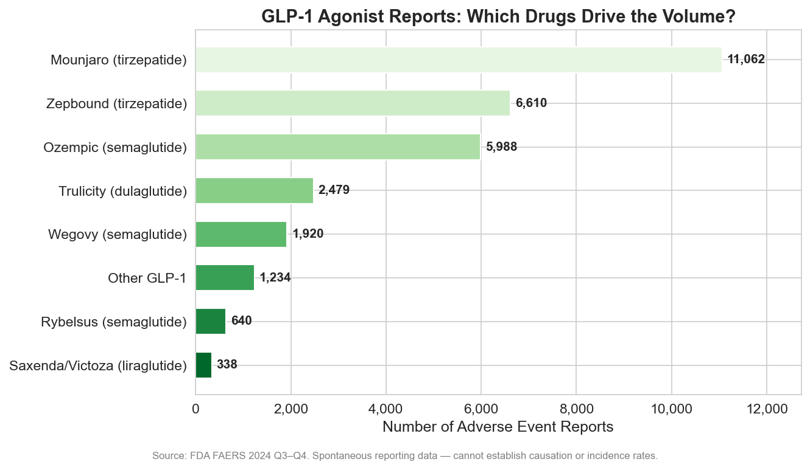

# The GLP-1 Boom and Its Side Effects: What 30,000 Adverse Event Reports Reveal

*A data story using the FDA Adverse Event Reporting System (FAERS), Q3–Q4 2024*

---

## The Most Reported Drug Class in America

Mounjaro. Ozempic. Wegovy. Zepbound. These names have moved from endocrinology clinics to dinner table conversations in under three years. GLP-1 receptor agonists — originally developed for type 2 diabetes — have become the most talked-about drug class in a generation, driven by their dramatic efficacy for weight loss.

The FDA's adverse event data tells the same story from a different angle. In just two quarters of 2024, GLP-1 agonists generated **30,271 adverse event reports** — dwarfing antidepressants (10,145) and ADHD medications (3,273) combined. Mounjaro alone accounted for over 11,000 reports. Zepbound, approved for weight loss in late 2023, already had 6,610.

This is not necessarily alarming. More prescriptions mean more reports. But the *pattern* of what's being reported — and by whom — reveals something important about how this drug class is being used in the real world.

*Figure 1: Adverse event report volume by drug class, FAERS Q3–Q4 2024.*

---

## Who's Reporting — and What That Tells Us

Two demographics dominate GLP-1 adverse event reports: **women** and **consumers**.

Sixty-two percent of GLP-1 reports come from female patients — compared to 50% for antidepressants and 34% for ADHD medications. This partly reflects prescribing patterns (weight management medications are prescribed more frequently to women), but it also signals the population most exposed to these drugs' side effects.

Even more striking: **86% of GLP-1 adverse events are reported by consumers**, not healthcare professionals. For antidepressants, that figure is 49%. For ADHD medications, 52%. GLP-1 agonists are overwhelmingly a consumer-reported phenomenon — patients are going directly to the FDA rather than through their physicians.

This matters because consumer reports tend to describe a different kind of experience than physician reports. They capture subjective suffering — the nausea that doesn't meet a clinical threshold but ruins your quality of life. The injection site pain that your doctor shrugs off. The hunger that returns when you miss a dose.

*Figure 2: Sex distribution of adverse event reports by drug class.*

*Figure 8: Reporter type distribution — GLP-1 reports are overwhelmingly consumer-initiated.*

---

## The Expected: GI Side Effects Dominate

The most commonly reported adverse events for GLP-1 agonists are exactly what clinical trials predicted: gastrointestinal distress.

- **Nausea** — 3,189 reports (PRR = 3.0)
- **Vomiting** — 1,969 reports (PRR = 2.9)
- **Diarrhea** — 1,798 reports
- **Constipation** — 1,242 reports (PRR = 3.2)

These are known side effects, listed on every label. But the volume is striking. One in ten GLP-1 users who filed a report cited nausea. The GI burden is not a footnote — it is the defining experience of this drug class for many patients.

Beyond the GI tract, injection site reactions make up a substantial share: **injection site pain** (2,702 reports, PRR = 5.4), **hemorrhage** (997, PRR = 12.2), **bruising** (644, PRR = 6.3), and **erythema** (797, PRR = 6.1).

*Figure 4: Top 10 most reported adverse events by drug class.*

---

## The Unexpected: Signals That Warrant Attention

Disproportionality analysis — comparing how often an adverse event is reported for GLP-1 agonists versus all other drugs — reveals several signals beyond the expected GI complaints:

**Impaired gastric emptying** — 733 reports, PRR = 55.3. This is the gastroparesis signal that has generated media attention and lawsuits. GLP-1 agonists work in part by slowing gastric motility; for some patients, this mechanism overshoots into clinical gastroparesis. The disproportionality ratio is massive — this event is reported 55 times more often for GLP-1 agonists than for other drugs.

**Medullary thyroid cancer** — 12 reports, PRR = 299.0. A known risk from preclinical studies in rodents, GLP-1 agonists carry a boxed warning for thyroid C-cell tumors. While 12 cases is a small number, the extreme disproportionality ratio confirms this signal is real, not noise.

**Pancreatitis** — 335 reports, PRR = 6.4. Another known but debated risk. The FAERS data shows it's being reported at 6 times the background rate.

**Intestinal obstruction** — 362 reports, PRR = 5.5. Related to the gastroparesis mechanism — severe slowing of GI motility can, in rare cases, progress to obstruction.

**Blood glucose changes** — Both increased (941 reports, PRR = 5.6) and decreased (276, PRR = 7.8). For a drug class that modulates glucose, swings in both directions are being reported.

*Figure 5: Strongest safety signals by Reporting Odds Ratio (ROR), with 95% confidence intervals.*

---

## The Dosing Problem

Perhaps the most surprising finding: the **single most reported adverse event** for GLP-1 agonists is not nausea or vomiting — it's **"incorrect dose administered"** (5,071 reports), followed by **"extra dose administered"** (1,773) and **"accidental underdose"** (1,046).

Nearly 8,000 reports — over a quarter of all GLP-1 adverse event reports — involve dosing errors. This is not a pharmacological side effect. It is a **usability problem**.

GLP-1 agonists are self-injected, typically weekly, with dose titration schedules that differ by product. Patients manage their own injections, track their own titration, and navigate pen devices that may be unfamiliar. The volume of dosing errors suggests that the delivery system is failing patients — particularly a population that is 86% consumer-reported and may have limited clinical oversight.

*Figure 7: GLP-1 agonist reports by specific drug. Mounjaro (tirzepatide) leads with 11,062 reports.*

---

## What This Means

GLP-1 agonists are effective. The clinical trial data is clear on that. But the FAERS data reveals the real-world experience that trials don't fully capture:

1. **The GI burden is substantial** — nausea, vomiting, and constipation are not just "transient" for many patients
2. **Gastroparesis is a real signal** — 733 reports with a PRR of 55 demands continued surveillance
3. **Dosing errors are epidemic** — the delivery system needs redesigning, better patient education, or both
4. **This is primarily a female patient population** — 62% of reports are from women, and sex-specific safety monitoring should be standard
5. **Patients are reporting directly** — 86% consumer reports suggests many patients lack adequate clinical follow-up

The GLP-1 revolution is real. But so are its side effects — and the system that monitors them is hearing primarily from patients themselves, not from their doctors.

---

## Methods

**Data source:** FDA Adverse Event Reporting System (FAERS), quarterly data extracts for Q3 and Q4 2024.

**Sample:** 784,523 deduplicated cases (latest case version retained per caseid). GLP-1 agonist cohort: 30,271 unique cases where a GLP-1 drug was the primary suspect (role_cod = 'PS').

**Drug matching:** GLP-1 agonists identified by generic name (semaglutide, liraglutide, tirzepatide, dulaglutide, exenatide, lixisenatide) and brand name in the drugname and prod_ai fields.

**Disproportionality analysis:** Proportional Reporting Ratio (PRR) and Reporting Odds Ratio (ROR) computed from 2×2 contingency tables (drug × event vs. all other drugs × event). 95% confidence intervals for ROR computed using Gart's method. Chi-square test with Yates' correction. Signal threshold: PRR ≥ 2, χ² ≥ 4, n ≥ 3, lower 95% CI of PRR > 1.

**Limitations:** FAERS is a spontaneous reporting system — it cannot establish causation, calculate incidence rates, or estimate risk. Reporting is voluntary and subject to stimulated reporting (media attention increases reports). The high consumer-report proportion may reflect media-driven awareness rather than clinical severity. Duplicate reports were reduced but not eliminated entirely.

**Tools:** Python 3.14, DuckDB, pandas, scipy, matplotlib, seaborn.
