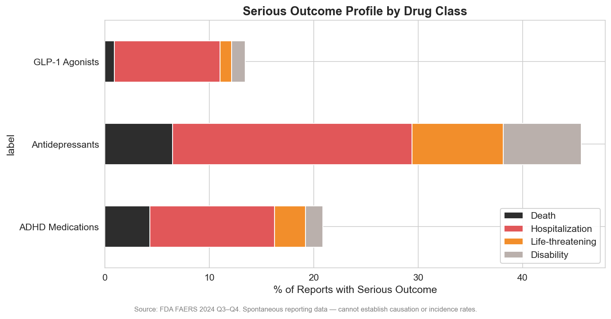
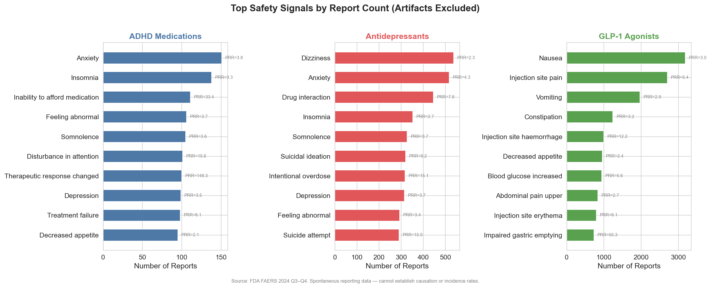

# The Side Effects No One Talks About: Antidepressant Safety Signals in FAERS

*A data story using the FDA Adverse Event Reporting System (FAERS), Q3–Q4 2024*

---

## 10,000 Reports in Six Months

Antidepressants are among the most widely prescribed drug classes in the United States. Over 13% of American adults used antidepressants in the past 30 days, according to the CDC — a number that has risen steadily for two decades. With that volume of use comes a steady stream of adverse event reports.

In Q3–Q4 2024, the FDA received **10,145 adverse event reports** where an antidepressant was the primary suspect drug. Sertraline (Zoloft) led with 1,268 reports, followed by bupropion (including the combination product Contrave), venlafaxine (Effexor), and escitalopram (Lexapro).

The antidepressant safety profile is the most clinically severe of the three drug classes we examined. Nearly **45% of reports included a serious outcome** — hospitalization, life-threatening event, disability, or death. That is more than double the serious outcome rate for GLP-1 agonists (13%).

*Figure 6: Serious outcome profile by drug class. Antidepressants have the highest rate of serious events.*

---

## The Signals Everyone Knows

Some antidepressant safety signals are well-established and appear prominently in the data:

**Suicidal ideation** — 321 reports (PRR = 9.2). **Suicide attempt** — 291 reports (PRR = 15.0). Together, over 600 reports of suicidality in six months. Antidepressants carry a black box warning for increased suicidality in young adults — the FAERS data confirms this signal remains active and robust. The PRR of 15 for suicide attempts means this event is reported 15 times more often for antidepressants than for drugs overall.

**Serotonin syndrome** — 266 reports (PRR = 46.3). A potentially life-threatening condition caused by excess serotonergic activity, often triggered by drug interactions. The strong disproportionality signal (reported 46 times more often than expected) underscores the real-world risk of combining serotonergic agents.

**Drug interaction** — 446 reports (PRR = 7.6). Antidepressants — particularly SSRIs and SNRIs — are CYP450 substrates and inhibitors. In polypharmacy environments, interactions are common and consequential.

---

## The Signal No One Discusses: Sexual Dysfunction

The most striking finding is also the most underreported in clinical practice.

**Sexual dysfunction** — 157 reports (PRR = 72.6). **Genital anaesthesia** — 18 reports (PRR = 458.0). **Female orgasmic disorder** — 10 reports (PRR = 381.7). **Orgasmic sensation decreased** — 12 reports (PRR = 458.0).

Read those PRR values again. Genital anaesthesia is reported **458 times more often** for antidepressants than for other drugs. These are not background noise. These are among the strongest disproportionality signals in the entire FAERS database.

Prospective studies using direct inquiry find SSRI-induced sexual dysfunction in 40–73% of patients (Montejo et al.), far higher than the 15–25% reported in clinical trials that relied on spontaneous reporting. The condition can persist after discontinuation — a phenomenon known as Post-SSRI Sexual Dysfunction (PSSD) that the European Medicines Agency formally recognized in 2019, now with over 24 PubMed-indexed publications.

The FAERS data suggests that when patients do report sexual side effects, the severity is profound — not just "decreased libido" but complete loss of genital sensation and orgasmic function. These reports are disproportionately from patients who felt their clinical team dismissed or minimized their symptoms.

*Figure 9: Top safety signals by report count, artifacts excluded. Antidepressants show distinct psychiatric and neurological signals.*

---

## Discontinuation: The Trap

**Antidepressant discontinuation syndrome** — 19 reports (PRR = 1,450.3). **Withdrawal syndrome** — 181 reports (PRR = 17.5).

A PRR of 1,450 is extraordinary. This is by far the strongest signal in the entire antidepressant dataset. Discontinuation syndrome — dizziness, nausea, "brain zaps," irritability, insomnia, and flu-like symptoms — occurs when patients stop or rapidly taper their antidepressant.

For decades, the psychiatric establishment maintained that antidepressants were "not addictive" and that discontinuation effects were mild and brief. Recent research has challenged this narrative. Davies and Read (2019, *Addictive Behaviors*) reviewed 14 studies and found discontinuation symptoms in approximately 56% of patients, with 46% rating symptoms as severe. A 2024 meta-analysis in *The Lancet Psychiatry* provided updated incidence figures confirming the scope of the problem.

The FAERS data, though limited by spontaneous reporting, aligns with the emerging picture: for some patients, getting off antidepressants is harder than getting on them.

**Abnormal dreams** (192 reports, PRR = 28.2) and **nightmares** (191 reports, PRR = 15.3) are related signals — vivid, disturbing dreams are a hallmark of both SSRI use and discontinuation.

---

## Who Reports Antidepressant Side Effects

The reporter profile for antidepressants sits between the other two classes:

- **50% female, 27% male** — a strong female skew, but less extreme than GLP-1 agonists
- **49% consumer, 23% physician** — a more balanced reporter profile than GLP-1
- **Age distribution is flat** — roughly equal reports from ages 18–34, 35–49, 50–64, and 65+, reflecting the broad prescribing base

The even age distribution is notable. Unlike GLP-1 agonists (concentrated in 35–64) or ADHD medications (concentrated in <18 and 18–34), antidepressant adverse events span the adult lifespan.

*Figure 3: Age profile of adverse event reports. Antidepressants show the most uniform age distribution.*

---

## What This Means

Antidepressants save lives. They remain a cornerstone of mental health treatment. But the FAERS data highlights three areas where the clinical conversation has lagged behind the patient experience:

1. **Sexual dysfunction is not a minor side effect** — PRR values of 400+ for genital anaesthesia and orgasmic disorders signal profound functional impairment that clinicians must proactively discuss
2. **Discontinuation is real and often severe** — the highest disproportionality signal in the dataset (PRR = 1,450) demands honest informed consent about the difficulty of stopping treatment
3. **Suicidality signals remain active** — 600+ reports of suicidal ideation and attempts in six months underscore the need for close monitoring, especially during initiation and dose changes
4. **Drug interactions are the hidden hazard** — in an era of polypharmacy, 446 interaction reports in six months is a pharmacist and prescriber concern
5. **The serious outcome rate is the highest of all three classes** — 45% of reports involve hospitalization, life-threatening events, disability, or death

Patients taking antidepressants deserve a more honest conversation about what these medications do — both the benefits and the costs.

---

## Methods

**Data source:** FDA Adverse Event Reporting System (FAERS), Q3–Q4 2024.

**Sample:** 10,145 unique cases where an antidepressant was the primary suspect drug. Drugs identified by generic name (sertraline, fluoxetine, escitalopram, citalopram, paroxetine, fluvoxamine, venlafaxine, duloxetine, desvenlafaxine, bupropion, mirtazapine, trazodone, vilazodone, vortioxetine, amitriptyline, nortriptyline, imipramine, desipramine, clomipramine, doxepin) and brand names.

**Disproportionality analysis:** PRR and ROR computed against the full FAERS database (784,523 cases). Signal threshold: PRR ≥ 2, χ² ≥ 4, n ≥ 3, lower 95% CI of PRR > 1.

**Limitations:** FAERS is a spontaneous reporting system — cannot establish causation or incidence. Antidepressant reports may be influenced by the nature of the underlying condition (depression itself causes suicidality, fatigue, sexual dysfunction). Confounding by indication is an inherent limitation. Serious outcomes may be overrepresented due to reporting bias (serious events are more likely to be reported).

**Tools:** Python 3.14, DuckDB, pandas, scipy, matplotlib, seaborn.
