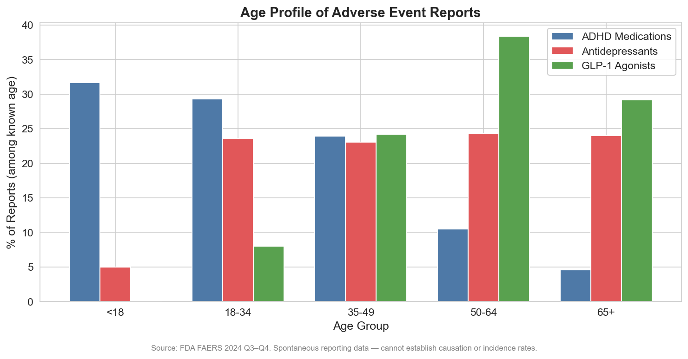

# Can't Get the Meds, Can't Afford the Meds: The ADHD Medication Crisis in Adverse Event Data

*A data story using the FDA Adverse Event Reporting System (FAERS), Q3–Q4 2024*

---

## A Different Kind of Adverse Event

Open the FDA's adverse event database for ADHD medications and you expect to find side effects: insomnia, appetite loss, anxiety, cardiovascular concerns. You find all of those. But the top signals tell a different story — one that has less to do with pharmacology and more to do with a system in crisis.

The **#2 most reported event** for ADHD medications is "product substitution issue" (237 reports, PRR = 44.0). **#3** is "product availability issue" (218 reports, PRR = 22.6). **#6** is "inability to afford medication" (111 reports, PRR = 33.4). **#10** is "therapeutic response changed" (100 reports, PRR = 148.3).

These are not pharmacological adverse events. They are system failures showing up in a safety database — because patients had nowhere else to report them.

---

## The Shortage That Won't End

Since late 2022, the United States has faced a persistent shortage of stimulant medications — methylphenidate (Ritalin, Concerta) and amphetamine salts (Adderall, Vyvanse). The DEA sets annual production quotas for Schedule II substances. When demand surged — driven by increased ADHD diagnosis rates and telehealth prescribing — supply could not follow.

The FAERS data captures the downstream consequences:

- **Product substitution issues** (PRR = 44.0): Patients forced to switch between generics, between formulations, or between entirely different medications when their usual drug is unavailable. Each substitution is effectively a medication change without clinical intent.
- **Therapeutic response changed** (PRR = 148.3): When patients switch to a different generic manufacturer or formulation, the "same" medication can feel different. Different inactive ingredients, different release profiles, different bioavailability within allowable ranges — all of which matter for a drug class with narrow therapeutic windows.
- **Product quality issues** (72 reports, PRR = 9.1) and **product physical issues** (68 reports, PRR = 20.1): Reports of pills that look different, taste different, or dissolve differently — often tied to unfamiliar generic manufacturers that ramped up production during the shortage.

The total picture: nearly **700 reports** (over 20% of all ADHD adverse event reports) relate not to what the drug does, but to whether patients can get it at all.

---

## The Affordability Signal

**Inability to afford medication** — 111 reports (PRR = 33.4). **Insurance issue** — 73 reports (PRR = 9.9).

These are among the strongest disproportionality signals in the dataset. Patients are filing FDA adverse event reports because they cannot pay for their medication. The PRR of 33 means this event is reported **33 times more often** for ADHD medications than for drugs overall.

This is almost certainly an undercount. The patients who can't afford their medication are also the least likely to know about or navigate the FDA's reporting system. What shows up in FAERS is the visible fraction of a much larger access crisis.

ADHD medications are disproportionately affected because:
- Stimulants are Schedule II controlled substances — no automatic refills, no 90-day supplies, no mail-order in many states
- Insurance often requires prior authorization, step therapy, or limits quantities
- Brand-name extended-release formulations (which have fewer side effects) are often not covered
- Generic shortages force patients to brand-name products at higher cost

---

## The Pharmacological Signals

Beyond the access crisis, ADHD medications produce a distinct safety profile:

**Psychiatric effects** are prominent:
- **Anxiety** — 151 reports (PRR = 3.8)
- **Insomnia** — 138 reports (PRR = 3.3)
- **Depression** — 99 reports (PRR = 3.5)
- **Suicidal ideation** — 92 reports (PRR = 7.6)
- **Irritability** — 75 reports (PRR = 11.9)
- **Aggression** — 73 reports (PRR = 12.6)

Stimulants are dopamine and norepinephrine reuptake inhibitors. Their psychiatric side effects — anxiety, mood changes, irritability — are mechanistically expected but still clinically significant, particularly in children and adolescents.

**Abuse potential** surfaces clearly:
- **Drug abuse** — 93 reports (PRR = 10.8)
- **Intentional overdose** — not in the top signals but present

**The cardiac signal** is the most clinically concerning:
- **Cardiac valve disease** — 57 reports (PRR = 80.5)
- **Palpitations** — 60 reports (PRR = 3.7)

A PRR of 80.5 for cardiac valve disease is a strong signal that warrants investigation. While stimulant-associated cardiovascular effects (tachycardia, hypertension) are well-documented, valvular disease is less expected and could reflect long-term use patterns or confounding.

**Cognitive effects** form a distinct cluster:
- **Disturbance in attention** — 101 reports (PRR = 15.6)
- **Brain fog** — 58 reports (PRR = 5.2)
- **Somnolence** — 105 reports (PRR = 3.6)

The irony is notable: patients take these medications to improve attention, and a subset report worsened attention as an adverse effect — possibly during titration, medication switches, or withdrawal.

*Figure 5: Strongest safety signals by Reporting Odds Ratio (ROR).*

---

## Who Reports ADHD Adverse Events

ADHD medications have the most balanced sex distribution of the three classes: **34% female, 34% male, 32% unknown**. This near-parity is notable given that ADHD is diagnosed in males at roughly 2:1 — suggesting either that female patients experience more adverse events per prescription, or that they are more likely to report.

The age distribution skews young: **32% of reports with known age come from patients under 18**, the highest pediatric proportion of any class. Another 29% come from ages 18–34. This is a drug class where children are the primary patient population — and where parents are often the reporters.

*Figure 3: Age profile of adverse event reports. ADHD medications have the youngest patient population.*

---

## What This Means

ADHD medication adverse event data tells two stories simultaneously:

**Story 1: The Access Crisis.** Over 20% of ADHD adverse event reports are about supply, affordability, and substitution — not pharmacology. The FAERS database was designed to capture drug safety signals, but patients have turned it into a chronicle of a system that cannot reliably deliver the medications they need. When "I can't get my medication" is the second most reported event for an entire drug class, the system has a problem that no pharmacovigilance algorithm can solve.

**Story 2: The Pharmacological Profile.** Among the actual side effects, psychiatric symptoms dominate — anxiety, insomnia, depression, irritability, aggression. The cardiac valve disease signal (PRR = 80.5) is the most clinically actionable finding and warrants further investigation. The attention-related adverse events (disturbance in attention, brain fog) suggest a subset of patients whose symptoms worsen rather than improve, particularly during medication changes.

**For clinicians:**
- When a patient reports that their medication "stopped working," ask about generic substitution before changing the prescription
- The cardiac valve disease signal deserves echocardiographic monitoring in long-term stimulant users
- Psychiatric side effects (irritability, aggression, suicidal ideation) require proactive screening, especially in pediatric patients

**For policymakers:**
- The DEA production quota system is creating a patient safety problem measurable in FDA adverse event data
- Prior authorization and insurance barriers for ADHD medications generate harm visible in the pharmacovigilance system
- The shortage has persisted for over two years — this is not a temporary disruption

---

## Methods

**Data source:** FDA Adverse Event Reporting System (FAERS), Q3–Q4 2024.

**Sample:** 3,273 unique cases where an ADHD medication was the primary suspect drug. Drugs identified by generic name (methylphenidate, amphetamine, dextroamphetamine, lisdexamfetamine, atomoxetine, guanfacine, clonidine) and brand names (Ritalin, Concerta, Adderall, Vyvanse, Strattera, Intuniv, Jornay, etc.).

**Disproportionality analysis:** PRR and ROR computed against the full FAERS database (784,523 cases). Signal threshold: PRR ≥ 2, χ² ≥ 4, n ≥ 3, lower 95% CI of PRR > 1.

**Limitations:** FAERS is a spontaneous reporting system — cannot establish causation or incidence. The ADHD cohort is the smallest of the three classes (3,273 cases), limiting power to detect rare signals. Access-related reports (supply, affordability) are not traditional adverse events and may reflect reporting behavior rather than drug safety concerns. The stimulant shortage may have caused stimulated reporting of supply-related issues.

**Tools:** Python 3.14, DuckDB, pandas, scipy, matplotlib, seaborn.
